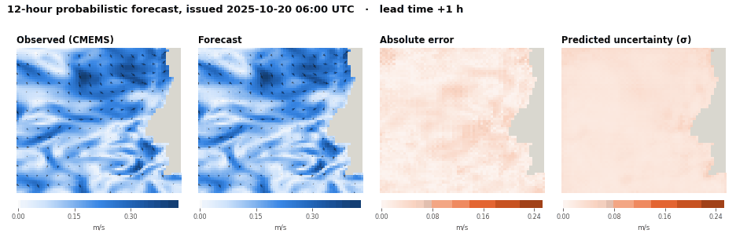
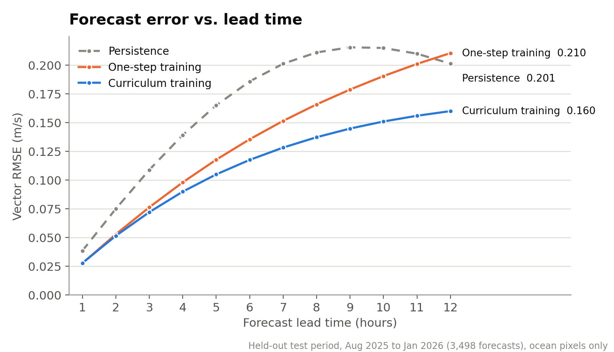
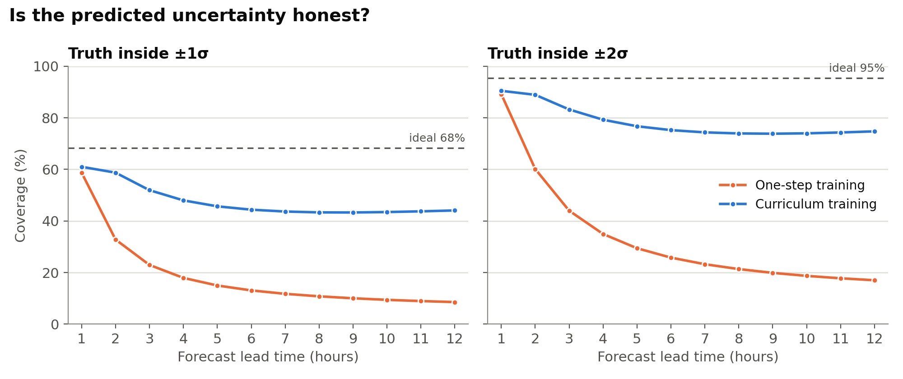
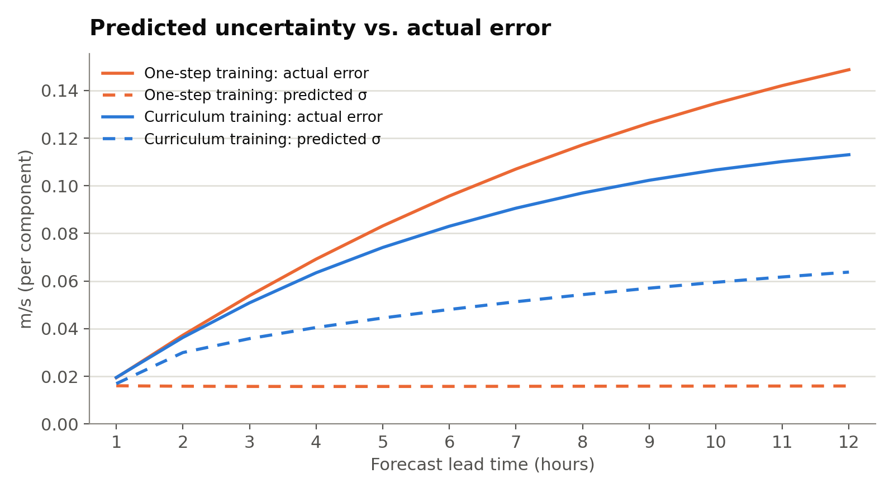
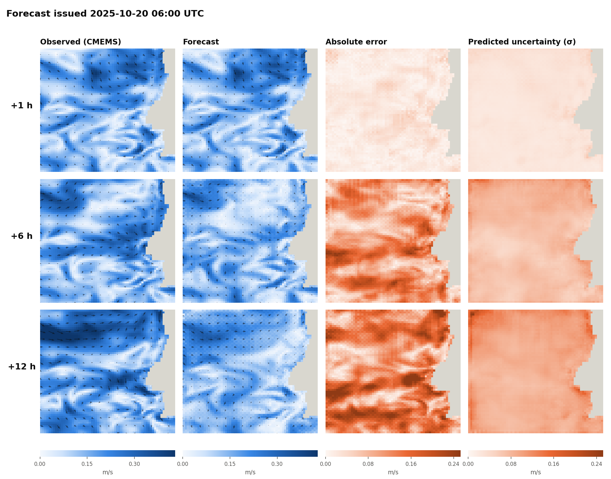
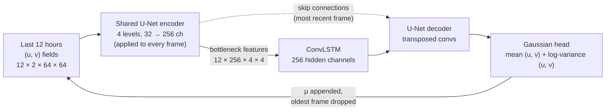

<div align="center">

# Ocean Current Forecasting

**Probabilistic 12-hour forecasts of ocean surface currents with a U-Net + ConvLSTM.**

A spatiotemporal deep-learning model that predicts the next 12 hours of the surface-current field off the coast of Portugal, together with a per-pixel uncertainty estimate. It runs in about 23 ms per forecast on a laptop GPU and beats persistence at every lead time on a held-out five-month test period.

[](https://github.com/svillhauer/ocean-current-forecasting/actions/workflows/ci.yml)




<sub>One forecast from the held-out test period. Left to right: the CMEMS reference field, the model's forecast mean, its absolute error, and the model's own predicted uncertainty. Arrows show current direction; grey is land (the Portuguese coast).</sub>

</div>

---

## Why

Marine robots such as underwater gliders travel at 0.25–0.4 m/s, about the same speed as the currents around them (here the median is 0.18 m/s, and the 95th percentile is 0.38 m/s). A path planner that ignores currents gets pushed off course, and one that trusts a single deterministic forecast has no idea when that forecast is likely to be wrong.

Operational ocean models give good forecasts, but they're expensive to run and are updated on a fixed schedule. This project learns a fast **emulator** that, given the last 12 hours of surface currents, produces:

- the **expected current field** for each of the next 12 hours, and
- a **per-pixel standard deviation** saying how far to trust it.

## Results at a glance

| Lead time | Persistence | One-step training | **Curriculum training** |
|:-:|:-:|:-:|:-:|
| +1 h | 0.038 | 0.028 (+28%) | **0.028 (+28%)** |
| +3 h | 0.109 | 0.076 (+30%) | **0.072 (+34%)** |
| +6 h | 0.186 | 0.135 (+27%) | **0.117 (+37%)** |
| +9 h | 0.215 | 0.179 (+17%) | **0.145 (+33%)** |
| +12 h | 0.201 | 0.210 (−5%) | **0.160 (+21%)** |

<sub>Vector RMSE in m/s (lower is better); skill relative to persistence in brackets. 3,498 forecasts issued hourly over a held-out test period (7 Aug 2025 to 1 Jan 2026), ocean pixels only. Reproduce with <code>scripts/evaluate.py</code>.</sub>

<p align="center">
  
</p>

Three findings stand out:

1. **Both models beat persistence by about 28% at one hour.** Persistence (assume nothing changes) is the standard baseline for short-range forecasting and is hard to beat in tidal water.
2. **Curriculum training is what makes the long range work.** Both models are the same network with the same data. The one trained only on one-step-ahead prediction drifts once it consumes its own outputs, and falls behind persistence by 12 hours. The curriculum model, fine-tuned on progressively longer rollouts of its own predictions, keeps a **21–37% skill advantage across the whole horizon**.
3. **Persistence error peaks near 9 hours and then falls.** The flow here is strongly tidal. The dominant semidiurnal tide has a 12.42-hour period, so by 12 hours the field has partly cycled back to where it started. Beating persistence at +12 h is therefore a demanding test.

## Uncertainty you can use

The model predicts a variance for every pixel and lead time, trained with a heteroscedastic Gaussian likelihood. A forecast's uncertainty is only useful if it's **calibrated**: if it claims ±1σ, the truth should land inside that band about 68% of the time.

<p align="center">
  
</p>

| | +1 h | +6 h | +12 h |
|---|:-:|:-:|:-:|
| **Coverage within ±1σ** (ideal 68%), one-step | 59% | 13% | 9% |
| **Coverage within ±1σ** (ideal 68%), curriculum | 61% | 44% | 44% |
| **CRPS** (m/s), one-step | 0.011 | 0.067 | 0.108 |
| **CRPS** (m/s), curriculum | **0.011** | **0.048** | **0.066** |
| MAE of persistence (m/s, for scale) | 0.021 | 0.101 | 0.109 |

- **The one-step model doesn't know it's compounding errors.** Its predicted σ is flat at 0.016 m/s for every lead time, because it only ever learned the uncertainty of a single hour.
- **The curriculum model's σ grows with lead time** (0.017 → 0.064 m/s) because it was trained on its own rollouts. Its coverage is far better and its CRPS (a proper score for probabilistic forecasts; it reduces to MAE for a deterministic one) is 39% lower at 12 hours.
- **It's still overconfident at long range** (44% within ±1σ against an ideal 68%). See [Limitations](#limitations--next-steps).

<details>
<summary><b>Predicted σ vs. actual error, per lead time</b></summary>

&nbsp;

<p align="center"></p>

A perfectly calibrated model would have each dashed line sitting on the solid line of the same colour.
</details>

<details>
<summary><b>Example forecast at +1 h, +6 h and +12 h</b></summary>

&nbsp;

<p align="center"></p>

At +1 h the forecast is nearly indistinguishable from the reference. By +12 h, fine-scale filaments are smoothed out, which is typical of models trained on pixel-wise losses, while the large-scale flow and its direction are preserved.
</details>

## Model



| Component | Design choice | Why |
|---|---|---|
| **Encoder** | 4-level U-Net encoder with shared weights, applied to each of the 12 input frames | Captures fronts, eddies and coastal jets at several spatial scales |
| **Temporal core** | ConvLSTM ([Shi et al., 2015](https://arxiv.org/abs/1506.04214)) on the 4×4 bottleneck | Learns dynamics (advection, tidal phase) over the 12-hour history while preserving spatial structure |
| **Decoder** | Transposed convolutions with skip connections from the most recent frame | Recovers fine detail at the coast and fronts |
| **Output** | Mean and log-variance per pixel and component; log-variance clamped to [−10, 5] | Aleatoric uncertainty ([Kendall & Gal, 2017](https://arxiv.org/abs/1703.04977)) |
| **Loss** | Heteroscedastic Gaussian negative log-likelihood | Learns *where* the forecast is unreliable, not just the mean |
| **Multi-step** | Autoregressive rollout; the predicted mean is fed back as input | One network, any horizon |
| **Curriculum** | Fine-tune on rollouts of 1 → 2 → 4 → 8 → 12 steps (100 epochs each, LR halved per stage, gradient clipping, mixed precision) | Teaches the model to correct its own drift, in the spirit of GraphCast's rollout fine-tuning ([Lam et al., 2023](https://arxiv.org/abs/2212.12794)) |

9.9 M parameters. Inference takes about 23 ms per 12-hour forecast when batched on an RTX 2000 Ada laptop GPU (8 GB).

## Data

| | |
|---|---|
| **Source** | [Copernicus Marine](https://marine.copernicus.eu) `GLOBAL_ANALYSISFORECAST_PHY_001_024`, dataset `cmems_mod_glo_phy_anfc_merged-uv_PT1H-i` |
| **Variables** | `utotal`, `vtotal`: total surface current = ocean circulation + tides (FES2014) + wave-driven Stokes drift |
| **Region** | Western Iberian margin, 36.25–42.42° N, 13.08–8.50° W (off Portugal), native 1/12° grid regridded to 64 × 64 |
| **Period** | 1 Jan 2024 to 1 Jan 2026, hourly: 17,545 fields |
| **Splits** | Chronological, never shuffled. Main models train on the first 70% (to 26 May 2025). The benchmark uses the final 20% (7 Aug 2025 onward), which no model trained on. |
| **Normalisation** | Per-component z-score, statistics from the training period only |

## Quickstart

```bash
git clone https://github.com/svillhauer/ocean-current-forecasting.git
cd ocean-current-forecasting
pip install -e ".[data,dev]"

# 1. Data: needs a free Copernicus Marine account (run `copernicusmarine login` once)
bash scripts/download_data.sh                     # -> data/cmems_iberia_uv_2024_2025.nc (~600 MB)

# 2. Pretrained weights (GitHub release assets)
gh release download v0.1.0 --dir weights

# 3. Reproduce the benchmark and figures
python scripts/evaluate.py --data data/cmems_iberia_uv_2024_2025.nc
python scripts/plot_benchmark.py
python scripts/render_forecast.py --data data/cmems_iberia_uv_2024_2025.nc --issue-time 2025-10-20T06:00
```

### Training

```bash
# One-step baseline
python scripts/train.py --data data/cmems_iberia_uv_2024_2025.nc --out runs/onestep \
    --curriculum 1 --epochs-per-stage 100

# Autoregressive curriculum (the headline model)
python scripts/train.py --data data/cmems_iberia_uv_2024_2025.nc --out runs/curriculum \
    --curriculum 1,2,4,8,12 --epochs-per-stage 100 --amp

# Architecture ablations
python scripts/train.py --data ... --out runs/abl --arch ablation --mode standard_unet --seq-len 3
```

Every checkpoint is self-describing: it stores the architecture, config, input length, normalisation statistics and training metadata alongside the weights, so `load_checkpoint(path)` alone is enough to run it. Validation always rolls out the full 12-hour horizon, so checkpoints from different curriculum stages are compared on the same task.

<details>
<summary><b>Early architecture ablation</b></summary>

&nbsp;

An earlier experiment compared three variants with a **3-hour** input history: the full U-Net + ConvLSTM, the same network without skip connections, and a plain U-Net with frames stacked as channels (no recurrence). Evaluated on the same benchmark:

| Variant (3 h context) | +1 h | +6 h | +12 h |
|---|:-:|:-:|:-:|
| U-Net + ConvLSTM | 0.089 | 0.214 | 1.13 |
| No skip connections | 0.103 | 0.284 | 0.337 |
| No recurrence (stacked-frame U-Net) | 0.059 | diverges | diverges |
| *Persistence* | *0.038* | *0.186* | *0.201* |

None of these beat persistence. The stacked-frame U-Net is the best of the three at one hour, but its autoregressive rollout is **unstable**: the error explodes by orders of magnitude within a few steps. This motivated the final design, with a 12-hour context, recurrence, and rollout training.

This is not a controlled ablation, because these variants also differ from the final model in learning rate, ConvLSTM width and normalisation layers. A clean ablation at a 12-hour context is on the roadmap.
</details>

## Repository layout

```text
ocean-current-forecasting/
├── src/currentcast/
│   ├── data.py               # NetCDF loading, regridding, z-score stats, sliding windows
│   ├── models/
│   │   ├── convlstm.py       #   ConvLSTM cell
│   │   ├── unet_convlstm.py  #   U-Net + ConvLSTM, Gaussian head, NLL loss
│   │   └── ablation.py       #   architecture ablation variants
│   ├── forecast.py           # autoregressive rollout, persistence baseline
│   ├── training.py           # one-step / curriculum training loop
│   ├── metrics.py            # RMSE, CRPS, interval coverage, skill (ocean-masked, per lead time)
│   ├── checkpoint.py         # self-describing checkpoints
│   └── plotting.py           # figure style
├── scripts/
│   ├── download_data.sh      # Copernicus Marine subset
│   ├── train.py              # train any configuration
│   ├── evaluate.py           # benchmark vs persistence -> results/benchmark.json
│   ├── plot_benchmark.py     # README charts
│   └── render_forecast.py    # forecast GIF + panels
├── results/benchmark.json    # full per-lead-time metrics behind every number above
├── tests/                    # 24 unit tests, CPU-only, no data needed
└── docs/media/               # figures
```

## Testing

```bash
pytest       # windowing/alignment, normalisation, rollout mechanics, metrics, training loop
ruff check .
```

The tests pin down the details that are easy to get silently wrong in forecasting code. Each input window's targets must be the frames *immediately* after it, the rollout must slide its window correctly, the metrics must ignore land, and CRPS must reduce to MAE for a deterministic forecast. CI runs them on Python 3.10 and 3.12 with CPU-only PyTorch.

## Limitations & next steps

- **Overconfident at long lead times.** The variance head models uncertainty one step at a time, so it underestimates how errors compound over a rollout. Next: a deep ensemble or variance propagation through the rollout, and post-hoc recalibration.
- **The reference is a model, not the ocean.** CMEMS analysis fields are themselves a model product, so this network learns to emulate it. Validating against HF-radar surface currents off Portugal would measure real-world skill.
- **Stronger baselines.** Persistence is the standard floor. The natural next comparisons are the CMEMS operational forecast itself, and a tidal-harmonic prediction plus persistence of the residual.
- **Smoothing at long range.** Pixel-wise losses blur fine filaments as lead time grows; spectral or adversarial losses, or diffusion-based generation, could keep them sharp.
- **Fixed region and resolution.** The model is trained for one 64 × 64 domain at the surface only.

## License & acknowledgements

Code is released under the [MIT License](LICENSE).

Data: E.U. Copernicus Marine Service Information (CMEMS), product `GLOBAL_ANALYSISFORECAST_PHY_001_024`.
